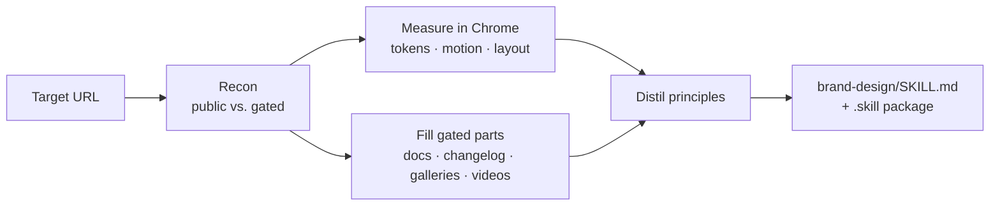

<div align="center">

# 🎨 design-steal

**Turn any website into a reusable design-system skill for Claude.**

Point it at a product — Linear, Stripe, Vercel, Raycast, Notion… — and get back a `<brand>-design` skill with the tokens, typography, spacing, components and *motion* that make it look and feel the way it does.

[](https://github.com/kevincostes/design-steal/releases/latest/download/design-steal.skill)
[](https://github.com/kevincostes/design-steal/releases/latest)
[](LICENSE)

</div>

---

## Why

Design-system docs tell you the colors. They rarely tell you **how the product moves**, why the spacing feels the way it does, or which five rules you'd break to make a clone look *off*.

`design-steal` measures the live site in Chrome, fills the gaps behind the login with official docs and screenshots, and writes it all down as an opinionated skill in the style of `apple-design`: principles first, real values as evidence, copy-paste CSS/JS and a Quick Reference table.

## What you get

A `<brand>-design/SKILL.md` that Claude can load later to build UI that looks like the original:

| Section | Contents |
| --- | --- |
| **Core Idea** | The through-line of the design language + signature traits |
| **Color** | Palette as CSS custom properties, light/dark handling |
| **Typography** | Families, scale, tracking and leading per size |
| **Spacing & layout** | Base unit, scale, containers, grid, density |
| **Shape & elevation** | Radii, shadows / borders / blur strategy |
| **Components** | Buttons, inputs, menus, modals, toasts… with states |
| **Motion** | Real durations, easings and springs per interaction |
| **Gated surfaces** | What was behind a login and where it was inferred from |
| **Quick Reference** | Every value with a confidence tag |

Every value is tagged so you know how much to trust it:

| Tag | Source |
| --- | --- |
| `measured` | Computed styles, stylesheets or `getAnimations()` on the live site |
| `documented` | The company's own design system or docs |
| `inferred` | Screenshots, videos, third-party galleries, tutorials |

## How it works



1. **Recon** — maps public and login-gated surfaces.
2. **Measure** — runs [`scripts/extract_tokens.js`](scripts/extract_tokens.js) on each page: most-used colors, type combos, spacing, radii, shadows, transitions, `:hover`/`:active` rules, `@keyframes`, breakpoints, CSS variables and the animation stack (Tailwind, Framer Motion, GSAP, Lenis, Radix…). Then hovers, opens and scrolls to capture motion live.
3. **Fill the gaps** — for gated UI it never logs in or bypasses paywalls; it pulls from official design systems, help centers, changelogs, open-source repos, Mobbin/Refero, YouTube walkthroughs and image search ([`references/sources.md`](references/sources.md)).
4. **Write** — follows [`references/output-template.md`](references/output-template.md) and packages the result.

## Install

**Claude app** — download [`design-steal.skill`](https://github.com/kevincostes/design-steal/releases/latest/download/design-steal.skill) and upload it in Claude's skills settings (or open it from a chat and click **Save skill**).

**Claude Code**

```bash
git clone https://github.com/kevincostes/design-steal.git ~/.claude/skills/design-steal
```

Requires the **Claude in Chrome** extension for live measurement. Without it, the skill falls back to docs and screenshots only.

## Usage

Just ask:

```text
Steal the design of linear.app and make me a linear-design skill
```

```text
Extract Stripe's design system — focus on the motion of the dashboard
```

```text
Quiero una skill con el design system de raycast.com
```

## Repository structure

```
design-steal/
├── SKILL.md                     # Workflow Claude follows
├── design-steal.skill           # Packaged skill, ready to install
├── LICENSE                      # MIT
├── scripts/
│   └── extract_tokens.js        # In-page token & motion extractor
└── references/
    ├── sources.md               # Where to look for gated UI
    └── output-template.md       # Shape of the generated skill
```

## Ethics

`design-steal` documents a **design language**, not brand assets. Generated skills leave out logos, proprietary icons, illustrations and marketing copy, and name free alternatives for paid fonts. Use the output to learn from great products and build your own. Don't use it to impersonate them.

## License

[MIT](LICENSE) © Kevin Costes

<div align="center">
<sub>Inspired by the <code>apple-design</code> skill · Built with Claude</sub>
</div>
